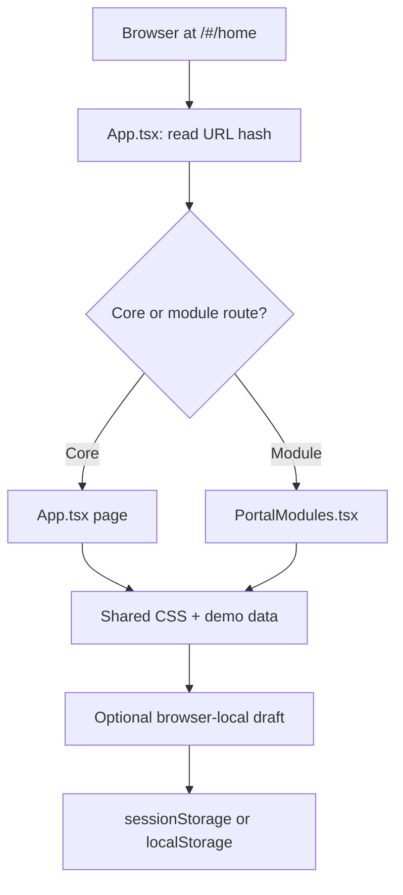
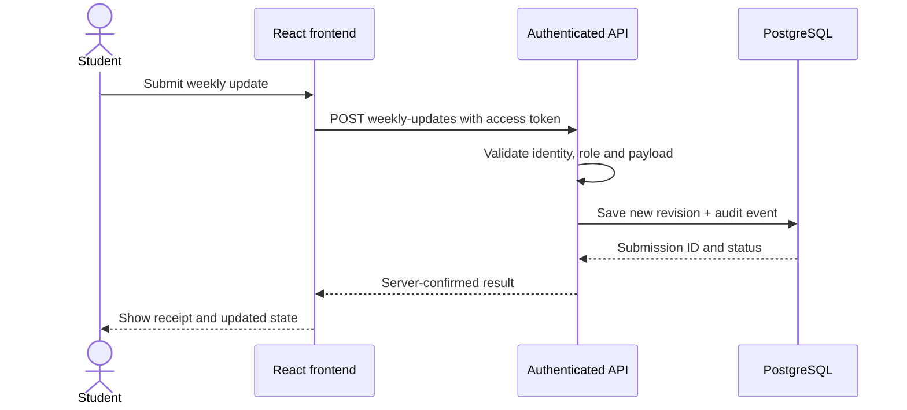

# Prathyusha Engineering College — FinTech Innovation Team Portal

### Complete Portal Frontend · React + TypeScript · Figma-to-Code Implementation

> **Status: interactive frontend demonstration.** This repository is a navigable, responsive implementation inspired by the linked Figma designs. It is **not** a production-ready, authenticated college portal. The sample students, tasks, approvals, reports and achievements are illustrative; saving a form in the browser does not submit it to an institutional system.

[](https://react.dev/)
[](https://www.typescriptlang.org/)
[](https://vite.dev/)
[](#current-implementation-status)

**Design reference:** [Prathyusha • FinTech demo 1 — Complete Portal, node `33:53`](https://www.figma.com/design/Lr3p1WlqpWXgVklhNV3f9Z/Prathyusha-%E2%80%A2-FinTech-demo-1?node-id=33-53)

**Directly open the demo after starting the app:**

- Public landing: <http://localhost:5173/#/home>
- Member login preview: <http://localhost:5173/#/login>
- Student dashboard: <http://localhost:5173/#/overview>
- Entire screen directory: <http://localhost:5173/#/directory>
- Eight dashboard modules: <http://localhost:5173/#/dashboards>

---

## Table of contents

1. [Project overview](#1-project-overview)
2. [Current implementation status](#2-current-implementation-status)
3. [Technology stack](#3-technology-stack)
4. [System requirements](#4-system-requirements)
5. [Installation and running the project](#5-installation-and-running-the-project)
6. [Project directory and architecture](#6-project-directory-and-architecture)
7. [Modules and feature coverage](#7-modules-and-feature-coverage)
8. [All 48 frontend routes](#8-all-48-frontend-routes)
9. [User roles and example journeys](#9-user-roles-and-example-journeys)
10. [Local data and draft persistence](#10-local-data-and-draft-persistence)
11. [Figma design system and responsiveness](#11-figma-design-system-and-responsiveness)
12. [Recommended backend integration](#12-recommended-backend-integration-not-yet-implemented)
13. [Security, consent and authorization requirements](#13-security-consent-and-authorization-requirements)
14. [Testing and acceptance checklist](#14-testing-and-acceptance-checklist)
15. [Deployment guide](#15-deployment-guide)
16. [Troubleshooting](#16-troubleshooting)
17. [Known limitations](#17-known-limitations)
18. [Roadmap](#18-roadmap)
19. [Team development workflow](#19-team-development-workflow)
20. [FAQ, credits and usage](#20-faq-credits-and-usage)

---

## 1. Project overview

The **FinTech Innovation Team Portal** is a conceptual college-based workspace for student innovation, project ownership, evidence-based contributions, faculty mentoring, hackathon activity, editorial publication and management reporting.

Its purpose is to give each stakeholder a coherent workflow rather than simply displaying static design artboards:

- **Applicants:** explore the FinTech community, express interest and view an illustrative application process.
- **Students:** find assigned projects, document individual contributions and draft weekly updates.
- **Team leads:** see project deliverables, milestones and event-team records.
- **Mentors:** review proposed work and record feedback drafts.
- **Faculty coordinators:** preview membership, evidence verification and publication decisions.
- **Magazine editors:** draft and review article/issue content.
- **Management viewers:** inspect illustrative, read-only reporting screens.

The app uses a shared institutional header, role-aware demonstration navigation, maroon sidebar, cream content backgrounds, cards, tables, forms and responsive layouts. **Changing roles in this demo does not authenticate a user or confer actual permissions.**

### Key figures

| Item | Current frontend |
| --- | --- |
| Registered navigable routes | **48** (`12` core routes + `36` module routes) |
| Demo navigation roles | **6**: applicant, student, mentor, coordinator, editor, management |
| Role-focused dashboard pages | **8** |
| Router mechanism | URL hash (`/#/route-name`) |
| Main application | React with TypeScript |
| Styling | Custom CSS and CSS variables |
| Data | Figma-inspired sample records and local browser drafts |
| Server, database and authentication | **Not included** |
| Production readiness | **Not claimed** |

## 2. Current implementation status

| Area | What currently works | What still requires engineering |
| --- | --- | --- |
| Navigation | URL hashes, sidebar, role-preview shortcuts, directory search/filter | Protected routing and authenticated session enforcement |
| Public portal | Community landing, example projects, event/innovator previews | CMS data, published records and consent checks |
| Login | Visual login form with role-based demo redirect | Real authentication, sessions, reset, MFA and role provisioning |
| Application | Required-field and email/URL checks; browser-session draft | Secure API, application ID generation, approval workflow and notifications |
| Applicant status | Example timeline and locally saved clarification | Actual server status, reviewer comments and resubmission |
| Profile | Editable demo fields and locally saved visibility preference | Real profile API, upload, fine-grained consent, approval |
| Contributions | Sample history and contribution draft inputs | Private evidence uploads, versioning and independent verification |
| Weekly work | Sample reporting/feedback and local update drafts | Persistent submissions, deadlines, mentor assignment and history |
| Project work | Overview, project detail, responsibility tables and delivery dashboard | Editable persistent tasks, assignment and due-date workflows |
| Hackathons | Event examples, team records and certificate-review screens | Real event registration, file storage and certificate verification |
| Coordinator/mentor | Example queues, feedback/decision-note drafts | Authorization, transactions, audited decisions and notifications |
| Magazine | Editorial pipeline, article forms and archive preview | Approval gate, editorial versions, media permissions, actual publishing |
| Reporting | Sample metrics, filters UI and browser print-to-PDF | Accurate backend aggregates, authorization, true filtered exports |

> **Important:** An example status labelled "Approved", "Verified" or "Published" is **not** evidence that any real college action happened. The front-end does not have an approval or verification backend.

## 3. Technology stack

### Runtime dependencies

| Technology | Version in `package.json` | Purpose |
| --- | --- | --- |
| React | `^19.0.0` | Component-based frontend |
| React DOM | `^19.0.0` | Browser rendering |
| Lucide React | `^0.468.0` | Icons |

### Developer dependencies

| Technology | Version | Purpose |
| --- | --- | --- |
| TypeScript | `^5.7.3` | Strongly typed components and route models |
| Vite | `^6.1.0` | Development server, bundling and static build |
| `@vitejs/plugin-react` | `^4.3.4` | React compiler integration |
| React type definitions | `^19.0.0` | TS typing for React and React DOM |

**Styling:** a single project stylesheet (`src/styles.css`) with responsive media queries. Tailwind CSS, Redux, React Router, Supabase, Firebase and a backend framework are **not dependencies of the current frontend**.

**Fonts:** the app requests **Manrope** through Google Fonts in `index.html`; system sans-serif is the fallback when the font cannot load.

## 4. System requirements

- Windows 10/11, macOS or Linux.
- **Node.js 22 LTS** recommended. A compatible Node.js 20.19+ runtime may also work; check Vite requirements for your selected version.
- npm installed with Node.js.
- A modern browser, such as Chrome, Edge, Firefox or Safari.
- Internet access for the initial `npm install` and for hosted Google Fonts.
- An editor such as Visual Studio Code (recommended but optional).

Check your installation:

```bash
node -v
npm -v
```

If either command is not found, install Node.js from <https://nodejs.org/> and reopen the terminal.

## 5. Installation and running the project

### A. Windows — VS Code (recommended)

1. Extract `Prathyusha_FinTech_Complete_Portal_React_Frontend.zip`.
2. Open the **inner `fintech_figma` folder**, the folder containing `package.json`, in VS Code.
3. Select **Terminal → New Terminal**.
4. Run:

```powershell
npm install
npm run dev
```

5. Open the **Local** URL printed by Vite (normally <http://localhost:5173/>).

Or run **`RUN_WINDOWS.bat`** from the project folder. That script checks Node.js, runs `npm install`, then starts Vite.

### B. macOS / Linux

```bash
cd fintech_figma
npm install
npm run dev
```

### C. Run the built app locally

```bash
npm run build
npm run preview
```

The preview command prints its own address; it is often `http://localhost:4173`, but use the address reported in the terminal.

### D. Available npm commands

| Command | Behavior |
| --- | --- |
| `npm install` | Install project dependencies; requires registry access |
| `npm run dev` | Start Vite development server on `0.0.0.0` |
| `npm run verify:source` | Run the custom source syntax/navigation/token checker |
| `npm run build` | Run TypeScript checking, then build static `dist/` assets |
| `npm run preview` | Preview the built `dist/` locally |

**Verification is not the same as a build:** `verify:source` checks TypeScript/JSX *syntax* and route references using the TypeScript parser. It is not a full application test, TypeScript type check or browser test. `npm run build` performs a stronger TS check and Vite compilation.

### E. Expected successful startup

A healthy Vite start normally reports a local link similar to:

```text
VITE v6.x.x ready
Local: http://localhost:5173/
```

If port 5173 is already occupied, Vite may choose a different port. Use the exact terminal URL.

## 6. Project directory and architecture

```text
fintech_figma/
├── .gitignore                 # Excludes dependencies, builds and local secrets
├── README.md                  # This project documentation
├── RUN_WINDOWS.bat            # Windows install/start helper
├── index.html                 # Browser entry, title, favicon/meta and font link
├── package.json               # Scripts and dependencies
├── tsconfig.json              # Strict TypeScript compiler configuration
├── vite.config.ts             # Vite/React build setup
├── scripts/
│   └── verify.cjs             # Source syntax, route and color-token checks
└── src/
    ├── main.tsx              # React root mount
    ├── App.tsx                # App shell, core routes and shared layouts
    ├── PortalModules.tsx      # Module routes, demo dashboards and workflows
    ├── styles.css            # Visual tokens, styling and responsive rules
    └── assets/
        └── .gitkeep           # Put authorized official assets here
```

### Component responsibilities

**`src/main.tsx`** mounts the React app and loads global styles.

**`src/App.tsx`** defines the app shell, institutional header, sidebar, landing page, applicant form/status, student overview, editable profile, example core pages, notifications and hash navigation.

**`src/PortalModules.tsx`** defines module-specific routes, the screen directory, demo role navigation, shared form/table/stat UI helpers, workflow screens and dashboards.

**`src/styles.css`** owns design variables, the main desktop layout, mobile breakpoints, focus states, form styling, dashboard boards and print rules.

**`scripts/verify.cjs`** performs static project-specific checks and prints results to the terminal.

### Current navigation architecture



This is an **in-browser UI architecture**. It should not be interpreted as a backend data pipeline.

## 7. Modules and feature coverage

### 7.1 Public & membership

- Public FinTech landing page with three learning focus areas: **digital payments**, **financial intelligence** and **banking/trust**.
- Illustrative project descriptions and community/public-detail preview pages.
- Member login page: visual form and manual role-selection **demo shortcut** (not authentication).
- Membership form capturing name, institutional email, institutional identifier, department, academic year, skills, interests, motivation and optional portfolio.
- Internal-record consent is required by the demonstration form; public-profile consent is separately optional.
- Application status timeline and local clarification response.

### 7.2 Student experience

- Student overview with activity metrics and current-priority panel.
- Assigned-project summaries and detailed project responsibilities/milestones.
- Individual contribution history and draft form with work description, outcome and evidence URL.
- Weekly progress history and weekly-draft form.
- Editable profile and publication-consent preference.
- Sample notification center with read/unread UI.

### 7.3 Mentoring and verification

- Mentor review queue, student-record overview and feedback draft.
- Hackathon activity and event/team draft forms.
- Certificate review with example evidence state and reviewer remarks.
- Coordinator action center and membership review decision-note draft.

### 7.4 Publications and reports

- Magazine editorial pipeline, article editor and issue archive preview.
- Publication-approval demonstration and publishing checklist examples.
- Management report views and print-friendly CSS. The `Print / save PDF` button invokes the browser print dialog, **not a generated server PDF**.
- Roles/audit and recovery governance **preview** screens.

### 7.5 Eight dashboards

1. **Project delivery** — sample Kanban tasks, deliverables and milestones.
2. **Contribution insights** — verification counts and focus-area progress.
3. **Weekly progress** — commitments, blockers and mentor feedback.
4. **Hackathon operations** — event/team readiness and evidence completeness.
5. **Mentor command centre** — assigned work and review inbox.
6. **Coordinator overview** — membership, decisions and project health.
7. **Magazine editorial** — article pipeline and approval status.
8. **Management insights** — reported totals and sample breakdowns.

## 8. All 48 frontend routes

**Routing note:** This project does **not** use React Router. Each route is opened at `http://localhost:5173/#/<route>`. For example, `projects` is `http://localhost:5173/#/projects`.

### 8.1 Public & applicant routes

| Route | Purpose |
| --- | --- |
| `home` | Public landing and community sections |
| `login` | Member login demonstration |
| `apply` | Membership form |
| `status` | Application timeline and clarification |
| `issue-archive` | Example public magazine issue |
| `showcase` | Public project showcase |
| `innovators` | Example consented innovator profile |
| `events-achievements` | Event and achievement preview |
| `respond-clarification` | Separate clarification-response draft |

### 8.2 Student, project and weekly routes

| Route | Purpose |
| --- | --- |
| `overview` | Student landing dashboard |
| `profile` | Profile and privacy settings |
| `projects` | Project list and task overview |
| `project-detail` | Project responsibilities and milestones |
| `contributions` | Core contribution-entry UI |
| `contribution-log` | Contribution records and review examples |
| `add-contribution` | Extended contribution draft form |
| `weekly` | Weekly progress, revisions and history |
| `weekly-submission` | Detailed weekly form |
| `history` | Core activity history |
| `hackathons` | Hackathon records and event activity |
| `magazine` | Student magazine information and entry screen |
| `event-team` | Event/team registration draft |
| `notifications` | Readable example notifications |

### 8.3 Faculty, editorial and management routes

| Route | Purpose |
| --- | --- |
| `mentor-review` | Mentor feedback/review examples |
| `certificates` | Certificate and outcome review |
| `coordinator` | Coordinator operations overview |
| `membership-review` | Membership decision-note draft |
| `reports` | Report summaries and print |
| `editorial` | Magazine editorial pipeline |
| `article-editor` | Article editing form |
| `roles-audit` | Permissions and audit preview |
| `publication` | Publication approval draft |
| `decision-preview` | Illustrative approval summary |
| `correct-certificate` | Certificate correction example |
| `profile-correction` | Profile/correction/visibility example |
| `recovery` | Recovery/ownership governance example |
| `report-preview` | Simplified report preview |

### 8.4 Directory, state preview and dashboards

| Route | Purpose |
| --- | --- |
| `directory` | Search and filter available workflow entries |
| `dashboards` | Dashboard collection landing |
| `interface-states` | Loading, empty, error and access examples |
| `delivery-dashboard` | Project delivery dashboard |
| `insights-dashboard` | Contribution insights dashboard |
| `progress-dashboard` | Weekly progress dashboard |
| `hackathon-dashboard` | Hackathon operations dashboard |
| `mentor-dashboard` | Mentor dashboard |
| `coordinator-dashboard` | Coordinator dashboard |
| `editorial-dashboard` | Editorial dashboard |
| `management-dashboard` | Management dashboard |

**Count:** 9 + 14 + 14 + 11 = **48 routes**. The original Figma canvas also includes mobile/wireframe artboards and alternate design states; these are not necessarily separate React routes.

## 9. User roles and example journeys

| Demonstration role | Starting point | Example workflow |
| --- | --- | --- |
| Applicant | `/#/home` or `/#/apply` | Explore → fill application → view status |
| Student | `/#/overview` | Projects → record contribution → draft weekly update |
| Mentor | `/#/mentor-dashboard` | Open assigned queue → inspect evidence → draft feedback |
| Coordinator | `/#/coordinator` | Review applications → inspect certificate queues → draft decision |
| Editor | `/#/editorial-dashboard` | Open article → edit draft → inspect publication checklist |
| Management | `/#/management-dashboard` | View sample reports → open report preview → print |

### Walkthrough A — membership application

1. Open `/#/apply`.
2. Complete the required fields; enter a syntactically valid email address.
3. If you add a portfolio link, use an `http://` or `https://` URL.
4. Check the required internal record-keeping consent. Leave optional public consent unchecked if not desired.
5. Select **Submit application**.
6. You are taken to `/#/status`, where the submission is saved **only in your browser session**.

**There is no genuine application number, outgoing message, college account or review status created.**

### Walkthrough B — student weekly work

1. Go to `/#/overview` → `/#/projects`.
2. Open a sample project detail.
3. Open `/#/add-contribution` to draft your work description and a supporting URL.
4. Open `/#/weekly-submission` to save the weekly work draft.
5. Return to `/#/weekly` to review sample history and revision examples.

**The contribution/weekly module drafts do not update the example verified-statistics cards.** That requires a shared real data store and backend workflow.

### Walkthrough C — coordinator/mentor

1. Choose a demonstration role on `/#/login`, or go directly to `/#/mentor-dashboard` or `/#/coordinator`.
2. Open the review queue, read illustrative records and complete any available draft forms.
3. See the note that drafts are browser-only.

**Role switching is only a UI preview:** knowing a URL is sufficient to view these sample screens. It must not be used to host private institutional data.

## 10. Local data and draft persistence

The app currently uses the browser's built-in storage, with no network API calls for portal records.

| Browser mechanism | Example data | Scope |
| --- | --- | --- |
| `sessionStorage` | `pec-application-draft` | Current browser tab/session |
| `sessionStorage` | `pec-submitted-application`, `pec-submitted-flag` | Current browser tab/session |
| `sessionStorage` | `pec-module-<form-id>` | Local drafts for module forms |
| `localStorage` | `pec-profile` | Demo profile settings on this browser |
| `localStorage` | `pec-notices` | Read/unread sample notifications |
| `localStorage` | `pec-contributions`, `pec-week-update` | Core-page demo entries/revisions |
| `localStorage` | `pec-clarification`, `pec-clarification-sent` | Demo clarification state |
| `localStorage` | `pec-role` | Remembered demonstration role |

**Data-storage distinctions:**

- `sessionStorage` typically lasts until the tab/session ends; browser restore behavior can vary.
- `localStorage` can persist across reloads until cleared, but is device/browser-specific and can be deleted at any time.
- Neither mechanism synchronizes records between users.
- Neither is an appropriate storage solution for genuine student IDs, institutional passwords, private evidence or reviewer decisions.
- There is **no database migration, database URL or `.env` configuration** required for the current UI demo.

For safe demonstration, use invented names, fake register numbers and test-only URLs. **Never type a real password into the demo login form.**

## 11. Figma design system and responsiveness

### 11.1 Core theme tokens

Defined in `src/styles.css`:

| Token | Color | Use |
| --- | --- | --- |
| `--maroon` | `#890C25` | Primary actions, important text, highlights |
| `--dark` | `#351321` | Sidebar, featured panels, login brand panel |
| `--cream` | `#FAF7F2` | Main page background |
| `--soft` | `#F2E7E9` | Subtle control and tag backgrounds |
| `--gold` | `#E9BE72` | Accent, highlights and selected focus treatment |
| `--ink` | `#251D21` | Main text |
| `--muted` | `#766C70` | Supporting copy |
| `--line` | `#E7DFDA` | Light borders and separators |
| `--white` | `#FFFFFF` | Content card surfaces |

### 11.2 Main interface characteristics

- Manrope font with system-font fallback.
- Institutional header and role-specific sidebar in workspace layouts.
- Soft radius panels, table containers, pill badges and action buttons.
- Grid-based cards for summary statistics.
- Desktop presentation matching the design's general visual language.
- Responsive adjustments at widths such as **1150, 960, 780, 670 and 450 pixels**, depending on the component.
- Reduced-motion media-query support and keyboard-focus styling.
- Print CSS that hides navigation when printing reports.

### 11.3 Logo / image asset accuracy

**The official Prathyusha Engineering College logo file is not included.** The Figma connector supplied a temporary asset URL that was not retrievable from the original authoring environment. The current `Logo` component renders an **illustrative seal and text fallback**, not the original logo artwork.

To add the authorized original image:

1. Export the official logo artwork from Figma (for example, the logo instance at `34:76` on the linked canvas).
2. Save it locally as `src/assets/prathyusha-logo.png` or `.svg`.
3. Modify `Logo` in `src/App.tsx` to import and render that exact local file, keeping the intended dimensions and proportions.
4. Check the desktop header, public landing and mobile layouts at multiple widths.
5. Verify rights/authorization before publishing college brand artwork.

Do **not** use temporary Figma asset URLs as permanent image sources. Do not treat this repo as a perfect one-to-one conversion of every Figma wireframe, approval state and mobile artboard.

## 12. Recommended backend integration (not yet implemented)

The following is a **proposed next-stage architecture**, not part of the current ZIP.

### 12.1 Suggested stack

| Layer | Suggested choice | Notes |
| --- | --- | --- |
| Frontend | Keep React + TypeScript + Vite | Existing UI foundation |
| API | Node.js with NestJS or Express/Fastify | Choose one backend approach |
| Database | PostgreSQL | Member/workflow data and reporting |
| Authentication | Approved identity provider or secure institutional SSO | Must verify membership/roles on the server |
| Private files | Authorized object storage | Signed access, restrictions, malware scanning |
| Notifications | Email provider + server-side queue | Delivery status and retries |
| Audit | Append-only audit-event table/log | Actor, timestamp, action, prior and new states |
| Hosting | Static host + separately secured API | TLS, monitoring and backups |

Supabase is one possible combination for PostgreSQL, auth and storage, but **no Supabase integration is present or configured here**.

### 12.2 Suggested data entities

```text
User
InstitutionalIdentity
MembershipApplication
MemberProfile
RoleAssignment
Project
ProjectMember
Task
Contribution
ContributionEvidence
ContributionReview
WeeklyUpdate
WeeklyUpdateRevision
MentorFeedback
HackathonEvent
HackathonTeam
EventParticipation
Certificate
CertificateVerification
Article
MagazineIssue
PublicationApproval
Notification
AuditEvent
```

Separate **student-authored content** from **reviewer decisions**: an applicant cannot grant their own membership, a student cannot verify their own contribution, and an editor cannot bypass coordinator publication checks.

### 12.3 Proposed API contract (illustrative only)

These endpoints are **not implemented**. They illustrate how the frontend can be connected later.

| Method | Proposed path | Purpose |
| --- | --- | --- |
| `POST` | `/api/v1/applications` | Submit membership application |
| `GET` | `/api/v1/applications/me` | Read applicant's own status |
| `POST` | `/api/v1/applications/:id/clarifications` | Respond to a recorded request |
| `GET` | `/api/v1/me` | Read authenticated member/profile |
| `PATCH` | `/api/v1/me/profile` | Update authorized profile fields |
| `GET` | `/api/v1/projects` | List projects user is entitled to access |
| `GET` | `/api/v1/projects/:id/tasks` | Read assigned tasks |
| `POST` | `/api/v1/contributions` | Create contribution record |
| `POST` | `/api/v1/contributions/:id/evidence` | Associate private evidence metadata |
| `POST` | `/api/v1/weekly-updates` | Submit a dated update revision |
| `POST` | `/api/v1/reviews/:id/decision` | Record authorized review decision |
| `GET` | `/api/v1/notifications` | Authenticated notification inbox |
| `GET` | `/api/v1/reports` | Authorized, filtered report |
| `POST` | `/api/v1/publications/:id/approve` | Audited publication decision |

Each real write endpoint should perform authentication, object-level authorization, payload validation, consent checks where relevant, transaction handling and audit logging.

### 12.4 Intended interaction after integration



For actual APIs, retain drafts safely, include request IDs for troubleshooting, prevent double-submit and distinguish network failure from confirmed submission.

## 13. Security, consent and authorization requirements

**Do not deploy this frontend as a private-data system without a security review.**

Minimum production requirements:

- **Real authentication** using secure sessions/tokens; password handling must remain server-side with proven identity/auth libraries.
- **Role-based + record-level authorization** on every API endpoint and file access. UI hiding is not security.
- **Application moderation:** applicant approval must be performed by an authorized coordinator, never by changing local browser state.
- **Consent separation:** private internal membership data and optional public-profile publication must be separate decisions, with a clear withdrawal/correction process.
- **Private evidence storage:** enforce ownership, upload size/type controls, scanning, signed access and permission-aware downloads.
- **Data minimization:** collect and retain college IDs/contact details only where justified and permitted; never expose them on the public showcase.
- **Auditability:** store reviewer actor, action, reason, timestamp, record ID and previous/current status on protected server-side infrastructure.
- **Secure deployment:** HTTPS, strict CORS, secure cookie settings, CSRF protections when applicable, dependency scanning and server-side input validation.
- **Availability:** backups, migrations, retention policy, error monitoring and incident response.
- **Approval gates:** verify individual certificates and public media rights; verification alone must not cause publication.

**No real records or passwords should be entered into this demonstration.**

## 14. Testing and acceptance checklist

### 14.1 Checks already present in the repository

After `npm install`:

```bash
npm run verify:source
```

The source checker inspects:

- React/TypeScript **syntax** of `App.tsx`, `PortalModules.tsx` and `main.tsx`.
- The registered internal navigation targets.
- Presence of the expected core color tokens in CSS.

Earlier authoring checks reported that syntax and internal route references passed. **This is not a guarantee that production compilation or real browser interaction passes on every machine.**

### 14.2 Developer validation steps

```bash
npm run verify:source
npm run build
npm run preview
```

The full build executes `tsc --noEmit` before Vite builds. The original authoring environment could not reach the npm registry, so **a successful full `npm install` and production build was not established there**. Perform these commands on a machine with normal npm access.

### 14.3 Manual smoke tests

- [ ] Open `/#/home` without a blank screen or console exception.
- [ ] Open `/#/directory` and search for "weekly"; verify filtering.
- [ ] Navigate to all role dashboard previews.
- [ ] Apply form: blank required fields show errors.
- [ ] Apply form: malformed email shows an error; public consent is optional.
- [ ] Submit sample-only application and confirm the browser-session status view.
- [ ] Save profile and reload to check browser-local persistence.
- [ ] Save a contribution and weekly draft and confirm local saved-state feedback.
- [ ] Inspect notifications and mark a sample message as read.
- [ ] Open reports and test browser **Print / save PDF**.
- [ ] Test at approximately 1440, 1024, 768, 390 and 320 px viewport widths.
- [ ] Navigate using keyboard only, inspecting visible focus rings.
- [ ] Review mobile menu, forms, tables and overflow handling.
- [ ] Confirm no real institutional credentials or identifiers are used.
- [ ] Confirm the official logo is supplied before claiming exact brand fidelity.

### 14.4 Recommended tests to add next

`Vitest` + React Testing Library for components/forms; Playwright for navigation and role flows; accessibility scanning (for example axe); and API integration tests after a backend exists. **These test suites are recommendations, not currently installed test infrastructure.**

## 15. Deployment guide

### 15.1 Static production files

Run:

```bash
npm install
npm run build
```

If the command succeeds, the output appears in `dist/`. Deploy **the contents of `dist/`**, not the TypeScript source, to a static hosting service.

### 15.2 Vercel (static UI demo)

1. Push the project folder to a Git repository.
2. Create a new Vercel project connected to the repository.
3. Choose the Vite framework preset (or equivalent settings).
4. Use **Build command:** `npm run build`.
5. Use **Output directory:** `dist`.
6. Deploy and inspect the generated public URL.

If `fintech_figma` is a subfolder in a larger repository, set that folder as the project's **Root Directory**.

### 15.3 Netlify / Cloudflare Pages

| Setting | Value |
| --- | --- |
| Build command | `npm run build` |
| Publish/output directory | `dist` |
| Framework | Vite / static frontend |
| App base path | `/` for a root-domain deployment |

**Hash routing advantage:** paths such as `/#/projects` are handled by the browser after loading `/`, so they generally don't need the route-rewrite rules required by history-based routers. If deploying to a repository subpath (for example GitHub Pages), configure Vite's `base` appropriately and test the static asset paths.

### 15.4 Before publishing publicly

Remove or clearly mark illustration data; provide authorized college branding; verify interactions and responsive layouts; keep private real-member information out of this deployment; and connect/secure the backend before announcing login or approval capabilities.

## 16. Troubleshooting

| Problem | Likely cause / fix |
| --- | --- |
| `node` or `npm` not recognized | Install Node.js; restart VS Code/terminal |
| `package.json` not found | You opened the wrong directory; `cd` into `fintech_figma` |
| PowerShell blocks `npm.ps1` | Try `npm.cmd install` and `npm.cmd run dev`, or run Command Prompt |
| `npm install` fails | Check internet, npm registry settings, proxy, firewall; retry later |
| Port 5173 in use | Use the alternate URL Vite prints or start with `npm run dev -- --port 5174` |
| `vite` not recognized | Run `npm install` in the correct project first |
| Blank screen | Check terminal/browser console; check whether dependencies installed and the dev server is running |
| Build fails but source verification passes | Source verification does **not** run strict type checking; inspect the TypeScript error from `npm run build` |
| Fonts look different | Google Fonts unavailable; check network or use the system fallback |
| College logo is not exact | Official logo asset was not bundled; replace the illustrative fallback |
| Saved form not shown on another device | Drafts live in that browser's storage, not a shared database |
| Approval button didn't change real membership | The frontend contains no live approval or identity backend |
| Direct link doesn't load | Open `/#/route-name` and verify the host serves the app root |

For bug reports, include OS, Node/npm versions, exact command, terminal output, browser console error, expected behavior and relevant route.

## 17. Known limitations

1. **Frontend-only:** no real API, PostgreSQL, Supabase configuration or server-side workflow.
2. **No real login:** the role-selector/login form is a visual demo, not identity verification.
3. **No real protected upload:** evidence URLs may be stored in drafts, but no private file upload is connected.
4. **No live approvals or notifications:** review outcomes and messages are illustrative and cannot create institutional records.
5. **Example stats:** many dashboard counts and tables are hardcoded; they do not all update when local drafts are saved.
6. **Asset fidelity:** the exact authorized college logo is missing and replaced by a text/CSS fallback.
7. **Design fidelity:** the application is a responsive interpretation of Figma page `33:53`, **not a pixel-perfect implementation of every desktop, mobile, wireframe and state artboard**.
8. **Build validation:** syntax/source checks passed previously; full dependency install and production build still need to be performed in an environment with npm access.
9. **No automated test suite:** the custom verifier does not replace unit, integration, accessibility and end-to-end tests.
10. **No licensing declaration:** this project archive includes no `LICENSE` file. Do not assume public reuse rights for the college's brand assets or Figma design.

## 18. Roadmap

### Phase 1 — frontend stabilization

- [ ] Install dependencies and pass `npm run build` on the target development machine.
- [ ] Replace the temporary college-logo fallback with approved exact artwork.
- [ ] Run keyboard, mobile and accessibility checks.
- [ ] Add React component tests and key Playwright flow tests.
- [ ] Reduce duplicated page fragments and separate large components into focused files.

### Phase 2 — authenticated foundation

- [ ] Define the database schema and secure identity model.
- [ ] Implement student, mentor, coordinator, editor and viewer authorization.
- [ ] Establish safe session management and backend validation.
- [ ] Migrate browser-only forms to secure API requests.
- [ ] Add audit logging and private record permissions.

### Phase 3 — actual college workflows

- [ ] Membership approval/clarification and access activation.
- [ ] Projects, team memberships and persistent task assignments.
- [ ] Individual contribution evidence, reviews and version history.
- [ ] Weekly deadlines, resubmissions, mentor feedback and decisions.
- [ ] Hackathon/event participation and certificate association/verification.

### Phase 4 — publishing and insights

- [ ] Editorial reviews, author credits, approval and content versioning.
- [ ] Consent-aware public project/student showcases.
- [ ] Real filtered reports with correct verified versus submitted distinctions.
- [ ] Email/in-app notification delivery and preferences.
- [ ] Monitoring, backups, incident response and production readiness review.

## 19. Team development workflow

For collaborative development, a practical division is **frontend/UI**, **API/auth**, **database/roles**, **projects/tasks**, **contributions/weekly reviews**, **hackathons/certificates**, **magazine/reports**, and **quality/deployment**. These are suggested workstreams, not evidence that the corresponding backend modules already exist.

### Branch and review example

```bash
git checkout -b feature/student-profile
git add .
git commit -m "feat: improve student profile demo"
git push -u origin feature/student-profile
```

Suggested engineering rules:

1. Keep the default branch buildable.
2. Use pull requests and require at least one peer review before merge.
3. Make API contracts and permission checks explicit when adding real workflows.
4. Do not commit passwords, API secrets, `.env` files, institutional ID data or private evidence.
5. Use mock/test data in screenshots and demos.
6. Require successful type checking, build and core UI checks for changes.
7. Document new screens and routes here whenever the route registry changes.

### Definition of done for a frontend feature

- Functional behavior is clear and distinguishes draft from submitted.
- Supports desktop, tablet and mobile widths.
- Labels, focus handling and errors are accessible.
- Has no TypeScript errors; project builds successfully.
- New routes are registered and reachable from useful navigation.
- Real private data is not stored in the browser or included in screenshots.
- Appropriate tests and reviewer notes are included.

## 20. FAQ, credits and usage

**Q: Can I run this now in VS Code?**  
Yes, the frontend source has the expected Vite project structure. Install Node/npm dependencies and use `npm run dev`. A full production build was **not verified in the original authoring environment**, so run `npm run build` on your own machine and address any errors before deployment.

**Q: Is this the exact Figma design?**  
It follows the target's main content, maroon/cream/gold design tokens and layout patterns. The collection contains many artboards, including mobile/wireframe variants. This implementation covers navigable workflows, not perfect layer-for-layer reproduction.

**Q: Will signing in create a real account?**  
No. The login page is a role/navigation demonstration. Do not enter real passwords.

**Q: Where is the database?**  
There is none in this version. Drafts are stored in browser storage for demonstration only.

**Q: Are mentor reviews and certificates verified?**  
No. All displayed results are illustrative, and demo reviewer inputs are local drafts.

**Q: Can I deploy the demo to Vercel?**  
Yes, if the production build succeeds. Deploy only as a clearly labeled **public frontend demo** without genuine private records.

**Q: Can we turn this into a real team project?**  
Yes. Start with authenticated user/role requirements, database schema, permissions, secure evidence storage and API contracts before switching demo forms to live submissions.

### Credits and design attribution

- **Design concept:** Prathyusha Engineering College — FinTech Innovation Team Figma file, linked above.
- **Frontend implementation:** React + TypeScript adaptation of the reference design.
- **Icons:** [Lucide](https://lucide.dev/).
- **Fonts:** [Manrope](https://fonts.google.com/specimen/Manrope), with system fallback.
- **Framework documentation:** [React](https://react.dev/), [TypeScript](https://www.typescriptlang.org/), [Vite](https://vite.dev/).

The original design and institutional branding may have separate intellectual-property and publishing restrictions. Request permission when needed; this README does not grant a brand or design license.

---

**Project:** FinTech Innovation Team Portal  
**Institution:** Prathyusha Engineering College  
**Academic-year content in design:** 2026–2027 (illustrative)  
**Figma canvas:** `Lr3p1WlqpWXgVklhNV3f9Z`, node `33:53`  
**Repository type:** Frontend-only demonstration  
**Version in package:** `1.0.0`  
**Last README review:** 16 October 2026
